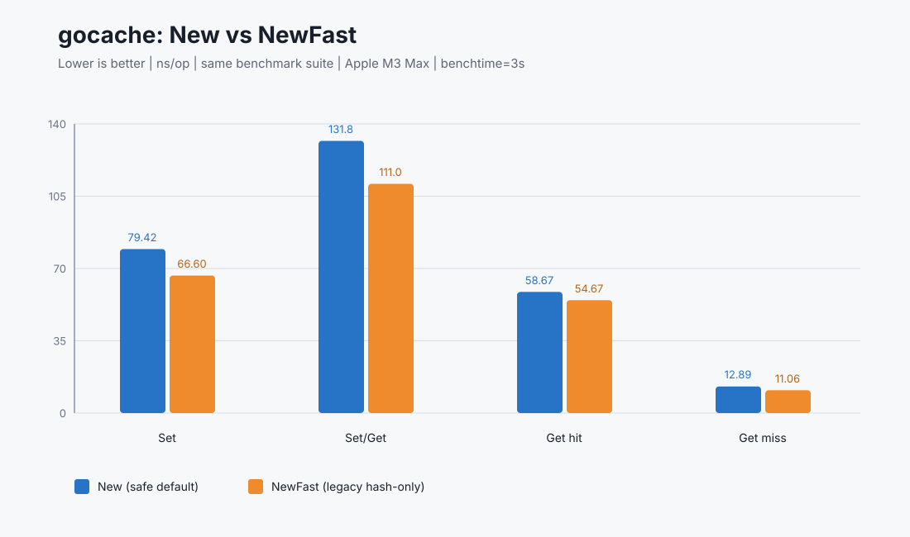
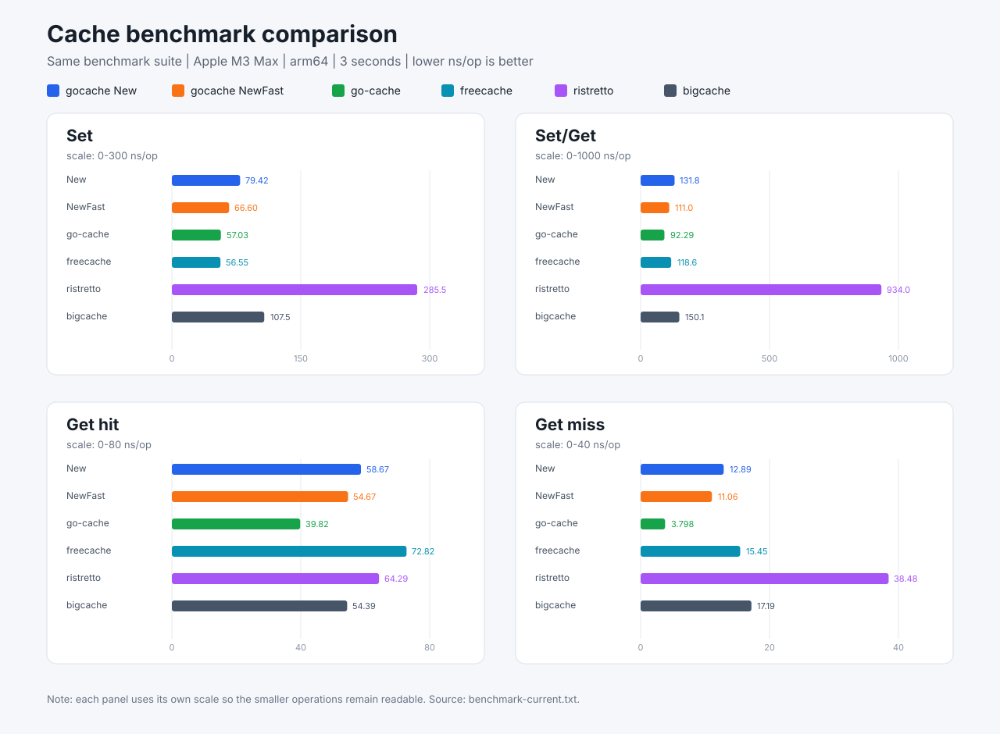

# ⚡ gocache – High-Performance 

[](https://godoc.org/github.com/jeffotoni/gocache) [](https://goreportcard.com/report/github.com/jeffotoni/gocache) [](https://github.com/jeffotoni/gocache/blob/main/LICENSE)  
[](https://dl.circleci.com/status-badge/redirect/gh/jeffotoni/gocache/tree/main)
[](https://coveralls.io/github/jeffotoni/gocache)
 


---

## 🚀 About gocache

**GoCache** is a high-performance, **sharded** in-memory cache for Go applications, built for **speed and efficiency**. This implementation is **optimized for concurrent read/write operations**, leveraging **sharding, lock optimizations, and expiration management** to outperform other Go-based caches.

## 🔥 **Why use gocache?**  
✅ **Ultra-fast read & write operations**  
✅ **Sharded architecture for minimal lock contention**  
✅ **Automatic expiration & cleanup of stale data**  
✅ **Simple API with support for TTL (Time-To-Live)**  
✅ **Benchmarked & optimized for real-world workloads**

---

# gocache in action 💕🐧🚀


## 📦 Installation

```sh
$ go get github.com/jeffotoni/gocache
```
## 🔥 Quick Start

```go
package main

import (
	"fmt"
	"time"
	"github.com/jeffotoni/gocache"
)

func main() {
	// Create cache with a 10-minute TTL
	cache := gocache.New(10 * time.Minute)
	
	// Store items in cache
	cache.Set("key1", "Hello, gocache!", gocache.DefaultExpiration)
	cache.Set("key2", 12345, gocache.DefaultExpiration)
	
	var myPerson = struct {
		ID int
		Name   string
	}{
		ID: 564,
		Name:   "@jeffotoni",
	}
	cache.Set("key3", myPerson, gocache.DefaultExpiration)
	
	// Retrieve items
	val, found := cache.Get("key1")
	if found {
		fmt.Println("Found key1:", val)
	}

	val, found = cache.Get("key2")
	if found {
		fmt.Println("Found key2:", val)
	}
	
	val, found = cache.Get("key3")
	if found {
		fmt.Println("Found key3:", val)
	}
	
	// Deleting an item
	cache.Delete("key1")

	// Attempting to retrieve deleted item
	val, found = cache.Get("key1")
	if !found {
		fmt.Println("key1 not found in cache")
	}
}
```

# 🛠 API Reference

## Safe cache: `New`

`New` is the default API and the recommended choice. It stores the original
key together with the hash, so different keys that produce the same hash remain
independent. It also supports optional limits and statistics.

```go
cache := gocache.New(10 * time.Minute)
defer cache.Close()

cache.Set("employee:BR307836", "employee payload", gocache.DefaultExpiration)

value, found := cache.Get("employee:BR307836")
if found {
    fmt.Println(value)
}

cache.Delete("employee:BR307836")
cache.Clear()
```

`DefaultExpiration` uses the TTL configured in `New`. Use
`NoExpiration` for an item that remains until `Delete` or `Clear`:

```go
cache.Set("geo:724:10:46", "Valencia", gocache.NoExpiration)
cache.Set("temporary", "value", 30*time.Second)
```

## Capacity limits and statistics

Use `NewWithOptions` when the cache needs a maximum number of entries or an
approximate byte limit. `TrySet` returns `false` when a new item is rejected by
one of those limits.

```go
cache := gocache.NewWithOptions(gocache.Options{
    TTL:        24 * time.Hour,
    MaxEntries: 10000,
    MaxBytes:   64 * 1024 * 1024,
    SizeFunc: func(key string, value interface{}) int64 {
        payload, ok := value.([]byte)
        if !ok {
            return int64(len(key) + 64)
        }
        return int64(len(key) + len(payload))
    },
})
defer cache.Close()

stored := cache.TrySet("oracle:geo:724:10", []byte("46"), gocache.DefaultExpiration)
if !stored {
    fmt.Println("cache capacity reached")
}

stats := cache.Stats()
fmt.Println("items:", stats.Items)
fmt.Println("hits:", stats.Hits)
fmt.Println("misses:", stats.Misses)
fmt.Println("expired:", stats.Expired)
fmt.Println("estimated bytes:", stats.EstimatedBytes)
```

`SizeFunc` is optional. Without it, the cache uses an approximate size based on
the key and common value types. `EstimatedBytes` is an estimate, not a process
RSS measurement.

## Type-safe cache: `NewTyped`

`NewTyped[T]` is a typed facade over the same safe v12 implementation. It keeps
the collision protection of `New` while avoiding type assertions in the
application code.

```go
type GeoResult struct {
    CodDestino string
}

cache := gocache.NewTyped[GeoResult](gocache.NoExpiration)
defer cache.Close()

cache.Set("geo:724:10:46", GeoResult{CodDestino: "46"}, gocache.DefaultExpiration)

result, found := cache.Get("geo:724:10:46")
if found {
    fmt.Println(result.CodDestino)
}
```

`NewTypedWithOptions[T]` accepts the same limits and statistics options as
`NewWithOptions`:

```go
cache := gocache.NewTypedWithOptions[GeoResult](gocache.Options{
    TTL:        24 * time.Hour,
    MaxEntries: 50000,
})
defer cache.Close()
```

The typed API provides `Set`, `TrySet`, `Get`, `Delete`, `Clear`, `Stats` and
`Close`. On a miss, `Get` returns the zero value of `T` and `false`.

## Fast legacy cache: `NewFast`

`NewFast` is an explicit opt-in API for compatibility and benchmark
comparisons. It delegates to `NewLegacyFast` and uses the older hash-only
storage strategy.

```go
cache := gocache.NewFast(gocache.NoExpiration)
defer cache.Close()

cache.Set("key", "value", gocache.DefaultExpiration)
value, found := cache.Get("key")
```

### Important collision warning

`NewFast` does **not** retain the original key. It stores one value per hash.
If two different keys produce the same hash, the later `Set` can overwrite the
first value. `Get` and `Delete` can then address the same hash entry even when
the requested strings are different.

```text
Set("key-A", valueA) -> hash H -> valueA
Set("key-B", valueB) -> hash H -> valueB replaces valueA
Get("key-A")          -> hash H -> valueB
```

This behavior is the trade-off for the legacy implementation's lower overhead.
Use `New` or `NewTyped` for geographic mappings, employee records, Oracle
results, or any data where the key must be exact. Use `NewFast` only when the
caller accepts the collision risk.

Both `New` and `NewFast` provide `Clear` and `Close`. Call `Close` when a cache
with a positive TTL is no longer needed so its cleanup goroutine can stop.

## Tests and coverage

Run the test suite:

```sh
go test -v ./...
```

Generate a coverage profile, print the function summary, and create an HTML
report:

```sh
go test -coverprofile=coverage.out ./...
go tool cover -func=coverage.out
go tool cover -html=coverage.out -o coverage.html
```

On macOS, open the report with:

```sh
open coverage.html
```

## Local benchmarks

The repository benchmarks only gocache implementations. The common operation
benchmarks compare the safe default `New` implementation against the explicit
legacy `NewFast` implementation. No external cache library is included in
these benchmarks.

Run all gocache benchmarks with allocation metrics:

```sh
go test -run '^$' -bench '^BenchmarkGocache' -benchmem -benchtime=3s
```

Run only the main `New` versus `NewFast` comparison:

```sh
go test -run '^$' -bench '^BenchmarkGocache(New|Set|SetWithTTL|GetHit|GetMiss|SetGet|SetDelete|Clear)' -benchmem -benchtime=3s
```

The additional benchmarks for `TrySet`, `Stats` and `TypedCache` measure v12
features that are not available in the legacy API. Benchmark results depend on
the CPU, Go version, cache state and `-benchtime`, so compare implementations
from the same command execution.

## Current gocache results: `New` vs `NewFast`

The following results were collected in the companion
`benchmark-gocache` repository. All implementations used the same benchmark
process, workload, machine and duration:

```sh
go test -run '^$' -bench '^BenchmarkCurrent' -benchmem -benchtime=3s -count=1
```

Environment: Apple M3 Max, arm64, Go 1.27.1. Lower `ns/op` is better.



| Operation | New ns/op | New B/op | New allocs/op | NewFast ns/op | NewFast B/op | NewFast allocs/op |
|-----------|----------:|---------:|--------------:|--------------:|-------------:|------------------:|
| Set | 79.42 | 88 | 2 | 66.60 | 48 | 2 |
| Set/Get | 131.8 | 88 | 2 | 111.0 | 48 | 2 |
| Get hit | 58.67 | 0 | 0 | 54.67 | 0 | 0 |
| Get miss | 12.89 | 0 | 0 | 11.06 | 0 | 0 |

The safe `New` implementation is slower because it preserves and compares the
original key, allowing multiple keys with the same hash to coexist correctly.
`NewFast` is faster because it stores one value per hash, but that is also its
correctness limitation. The two implementations must not be treated as
interchangeable when exact key isolation is required.

### Compatible reference table

This table uses the same four operations for every implementation. The
external caches were executed by the same `benchmark-gocache` benchmark suite,
not copied from older benchmark runs.

| Implementation | Set ns/op | Set/Get ns/op | Get hit ns/op | Get miss ns/op |
|----------------|----------:|--------------:|--------------:|---------------:|
| gocache New | 79.42 | 131.8 | 58.67 | 12.89 |
| gocache NewFast | 66.60 | 111.0 | 54.67 | 11.06 |
| go-cache | 57.03 | 92.29 | 39.82 | 3.798 |
| freecache | 56.55 | 118.6 | 72.82 | 15.45 |
| ristretto | 285.5 | 934.0 | 64.29 | 38.48 |
| bigcache | 107.5 | 150.1 | 54.39 | 17.19 |



Allocation results from the same run are available in the companion repository
file `benchmark-current.txt`. Benchmark numbers are hardware and workload
dependent; use the command above when reproducing them.

## Benchmark repository

The complete benchmark suite, raw output and implementation comparisons are
available in [benchmark-gocache](https://github.com/jeffotoni/benchmark-gocache).

## 🤝 Contributing

**🚀 Want to improve gocache? Follow these simple steps:**

 1️⃣ Fork this repo and add your own cache optimizations.

 2️⃣ Submit a Pull Request (PR) with your improvements.

 3️⃣ Open an issue if you have questions or ideas for enhancements.

**Your contributions are always welcome! 💡🔥**

## 📜 License

This project is **open-source** under the **MIT License**.

💡 Feel free to **fork, modify, and experiment** with these benchmarks in your own applications or libraries.  
🔬 The goal is to **help developers choose the best in-memory cache** for their needs.
